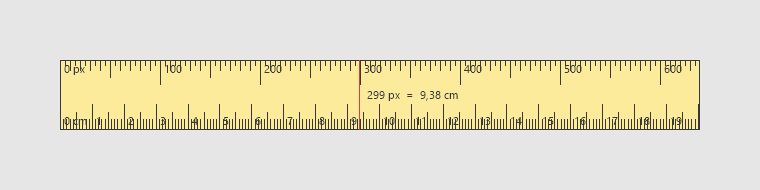

# Screen Ruler

Lightweight on-screen ruler for Windows: always on top, drag it with the mouse, switch between horizontal and vertical with a hotkey. One 32 KB exe, nothing to install.



[Deutsch weiter unten](#deutsch)

## Features

- Semi-transparent, borderless ruler that stays on top of all windows. Not shown in the taskbar, only as a tray icon.
- Pixel scale on the top edge, centimetre scale (with millimetres) on the bottom edge.
- Hover over the ruler to see the position in px and cm. Otherwise it shows the total length.
- Global hotkeys, mouse and keyboard control (see below).
- Click-through mode: mouse clicks go to the program underneath, e.g. to draw along the edge in Paint.
- Per-monitor DPI aware. The ruler keeps its pixel length on every monitor, and the cm scale adapts to each monitor.
- cm calibration per monitor (Windows does not always know the real monitor size).
- Remembers position, orientation, length, width, opacity and colour.
- Optional autostart with Windows (asks first, creates only a shortcut in your Startup folder).

The user interface is in German.

## Hotkeys and controls

| Input | Action |
|---|---|
| **Ctrl+Alt+L** | Show/hide the ruler (works everywhere) |
| **Ctrl+Alt+R** | Toggle horizontal/vertical |
| Drag with left mouse button | Move |
| Mouse wheel | Change length (10 px per notch, 1 px with Ctrl) |
| Shift+mouse wheel | Change width (5 px per notch, 1 px with Ctrl) |
| Arrow keys | Move by 1 px (10 px with Shift) while the ruler is active |
| Esc / Alt+F4 | Hide the ruler (keeps running in the tray) |
| Right-click on ruler or tray icon | Menu: show, rotate, click-through, settings, autostart, quit |

If a hotkey is already taken by another program, Screen Ruler tells you at startup and uses Ctrl+Alt+Shift+key instead. You can change the hotkeys in `lineal.ini` (`HotkeyToggle`, `HotkeyRotate`).

## Download

Get `ScreenRuler.exe` from the [Releases](../../releases) page and run it. It needs the .NET Framework 4.8, which is part of Windows 10 and 11.

Settings are stored in `lineal.ini` next to the exe, so put the exe in a folder you can write to.

**SmartScreen warning:** The exe is not code-signed. Windows may show "Windows protected your PC" on first start. Click *More info* and then *Run anyway*. If you prefer, build it yourself from source (see below).

## Calibrating centimetres

1. Move the ruler onto the monitor you want to calibrate.
2. Right-click the ruler and choose *Einstellungen* (settings).
3. Measure the 0 to 10 cm section with a real ruler, enter the result under *Gemessen (cm)*, click *Umrechnen*, then *OK*.

## Building

No SDK needed. The build script uses the C# compiler that ships with Windows (.NET Framework 4.8):

```powershell
powershell -ExecutionPolicy Bypass -File .\build.ps1
```

The result is `dist\ScreenRuler.exe`.

| File | Purpose |
|---|---|
| `src/Program.cs` | Startup, tray icon, menu, hotkeys, autostart, saving |
| `src/RulerForm.cs` | Ruler window, drawing, mouse and keyboard |
| `src/SettingsForm.cs` | Settings dialog |
| `src/Settings.cs` | Reading and writing `lineal.ini` |
| `src/HotkeyWindow.cs` | Global hotkeys |
| `src/Native.cs` | Windows API (DPI, window styles) |
| `app.manifest` | Per-monitor DPI awareness (V2) |

## License

MIT, see [LICENSE](LICENSE).

---

## Deutsch

Kleines Bildschirmlineal für Windows: immer im Vordergrund, mit der Maus verschiebbar, per Tastenkürzel waagerecht oder senkrecht. Eine einzige .exe mit 32 KB, keine Installation.

### Funktionen

- Halbtransparentes, randloses Lineal über allen Fenstern. Nicht in der Taskleiste, nur als Symbol im Infobereich.
- Oben Pixel-Skala, unten Zentimeter-Skala mit Millimetern.
- Fährt die Maus über das Lineal, zeigt es die Position in px und cm, sonst die Gesamtlänge.
- Durchklickbar-Modus: Mausklicks gehen an das Programm darunter, z. B. um in Paint an der Kante entlang zu zeichnen.
- Per-Monitor-DPI: Die Pixel-Länge bleibt auf jedem Monitor gleich, die cm-Skala passt sich an.
- cm-Kalibrierung je Monitor.
- Speichert Position, Ausrichtung, Länge, Breite, Deckkraft und Farbe.
- Autostart mit Windows auf Wunsch (fragt vorher, legt nur eine Verknüpfung im Autostart-Ordner an).

### Tastenkürzel und Bedienung

| Eingabe | Wirkung |
|---|---|
| **Strg+Alt+L** | Lineal ein/aus (überall) |
| **Strg+Alt+R** | Waagerecht/senkrecht umschalten |
| Linke Maustaste ziehen | Verschieben |
| Mausrad | Länge ändern (10 px je Raste, mit Strg 1 px) |
| Umschalt+Mausrad | Breite ändern (5 px je Raste, mit Strg 1 px) |
| Pfeiltasten | 1 px verschieben (mit Umschalt 10 px), wenn das Lineal aktiv ist |
| Esc / Alt+F4 | Lineal ausblenden (läuft im Infobereich weiter) |
| Rechtsklick auf Lineal oder Symbol | Menü: anzeigen, drehen, durchklickbar, Einstellungen, Autostart, Beenden |

Ist ein Kürzel schon belegt, meldet das Programm das beim Start und nimmt stattdessen Strg+Alt+Umschalt+Taste. Die Kürzel lassen sich in `lineal.ini` ändern.

### Herunterladen

`ScreenRuler.exe` unter [Releases](../../releases) herunterladen und starten. Benötigt das .NET Framework 4.8, das in Windows 10 und 11 enthalten ist. Die Einstellungen landen in `lineal.ini` neben der .exe.

**SmartScreen-Warnung:** Die .exe ist nicht signiert. Windows meldet beim ersten Start eventuell "Der Computer wurde durch Windows geschützt". Auf *Weitere Informationen* und dann *Trotzdem ausführen* klicken. Oder selbst aus dem Quellcode bauen.

### cm kalibrieren

Lineal auf den gewünschten Monitor schieben, Rechtsklick > *Einstellungen*, mit einem echten Lineal die Strecke 0 bis 10 cm messen, bei *Gemessen (cm)* eintragen, *Umrechnen*, *OK*.

### Bauen

Kein SDK nötig, das Skript nutzt den C#-Compiler aus Windows:

```powershell
powershell -ExecutionPolicy Bypass -File .\build.ps1
```

Ergebnis: `dist\ScreenRuler.exe`.

### Lizenz

MIT, siehe [LICENSE](LICENSE).
